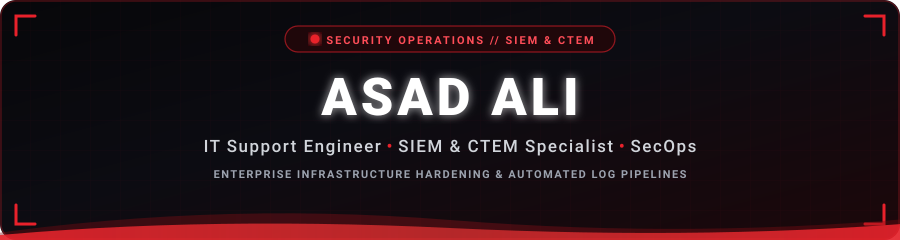
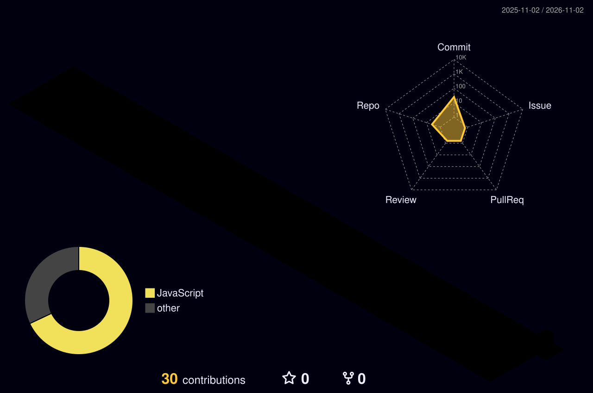

<!-- Animated Header Wave Banner (Self-Hosted) -->
<picture>
  <source media="(prefers-color-scheme: dark)" srcset="https://raw.githubusercontent.com/asadali-cyber25/asadali-cyber25/main/assets/header-banner.svg" />
  <source media="(prefers-color-scheme: light)" srcset="https://raw.githubusercontent.com/asadali-cyber25/asadali-cyber25/main/assets/header-banner.svg" />
  
</picture>

  

<!-- Animated Cyber Terminal Typing Headline (Self-Hosted) -->
<picture>
  <source media="(prefers-color-scheme: dark)" srcset="https://raw.githubusercontent.com/asadali-cyber25/asadali-cyber25/main/assets/typing.svg" />
  <source media="(prefers-color-scheme: light)" srcset="https://raw.githubusercontent.com/asadali-cyber25/asadali-cyber25/main/assets/typing.svg" />
  
</picture>

  

<!-- Interactive Quick Connect Badges -->

  

<!-- Profile View Counter -->

---

### 🛡️ About Me

Dedicated **IT Support Engineer** with a strong specialization in **Cybersecurity Operations**, focusing on **SIEM (Security Information & Event Management)** and **CTEM (Continuous Threat Exposure Management)**. 

- 📍 Based in **Gujrat, Pakistan** 🇵🇰
- 🏢 Associated with [**CyberSilo**](https://cybersilo.tech/)
- 🔧 Passionate about maintaining **enterprise system reliability**, deploying resilient log pipelines, and proactive threat exposure mitigation.
- 🎯 Open to **IT Support Specialist**, **Systems Administrator**, and **SOC / Security Analyst** roles.
- 💬 Ask me about: **Incident triage, enterprise server administration (Linux/Windows), telemetry pipelines, and security automation.**

---

### 🧰 Technical Arsenal & Tooling

<!-- Skill Icons Animated Strip -->

 

| Domain | Technologies & Frameworks |
|---|---|
| **🛡️ Security Operations** | `SIEM` · `CTEM` · `Log Pipelines` · `Threat Detection` · `System Hardening` · `Incident Response` · `Vulnerability Assessment` |
| **🐧 Operating Systems** | `Linux (Ubuntu / Debian / RHEL)` · `Windows Server 2019/2022` · `Active Directory` · `Group Policy (GPO)` |
| **🌐 Networking & Defense** | `TCP/IP` · `DNS / DHCP` · `Firewalls` · `pfSense` · `Wireshark` · `VPNs` · `Network Segmentation` |
| **⚡ Scripting & Automation** | `Bash Scripting` · `PowerShell` · `Python` · `Cron Automation` · `Git & GitHub Actions CI/CD` |
| **🔍 Monitoring & Telemetry** | `Syslog-ng / Rsyslog` · `Wazuh` · `Splunk` · `Elastic Stack` · `SNMP Monitoring` · `Event Forwarding` |

---

### 🐍 Contribution Activity Snake

<picture>
  <source media="(prefers-color-scheme: dark)" srcset="https://raw.githubusercontent.com/asadali-cyber25/asadali-cyber25/output/github-snake-dark.svg" />
  <source media="(prefers-color-scheme: light)" srcset="https://raw.githubusercontent.com/asadali-cyber25/asadali-cyber25/output/github-snake.svg" />
  
</picture>

> *The contribution snake is dynamically generated by an automated GitHub Actions workflow every 12 hours.*

---

### 📊 GitHub Activity & Analytics

<!-- GitHub Stats & Top Languages Cards -->

  

<!-- GitHub Streak Stats -->

---

### 🌐 3D Contribution Calendar

<picture>
  <source media="(prefers-color-scheme: dark)" srcset="./profile-3d-contrib/profile-night-rainbow.svg" />
  <source media="(prefers-color-scheme: light)" srcset="./profile-3d-contrib/profile-green-animate.svg" />
  
</picture>

> *Isometric 3D contribution matrix generated via daily GitHub Action.*

---

### 🤝 Let's Connect

Whether it's discussing **defensive security**, **SIEM deployment**, or an **IT infrastructure opportunity**, let's connect:

- 💬 **WhatsApp:** [+92 332 3155941](https://wa.me/923323155941)
- ✉️ **Direct Email:** [mrxasad33@gmail.com](mailto:mrxasad33@gmail.com)
- 🌐 **Company Website:** [CyberSilo](https://cybersilo.tech/)
- 💼 **LinkedIn:** [Asad Ali](https://www.linkedin.com/in/asadali-cyber25)

<!-- Animated Footer Wave Banner (Self-Hosted) -->
<picture>
  <source media="(prefers-color-scheme: dark)" srcset="https://raw.githubusercontent.com/asadali-cyber25/asadali-cyber25/main/assets/footer-banner.svg" />
  <source media="(prefers-color-scheme: light)" srcset="https://raw.githubusercontent.com/asadali-cyber25/asadali-cyber25/main/assets/footer-banner.svg" />
  
</picture>

